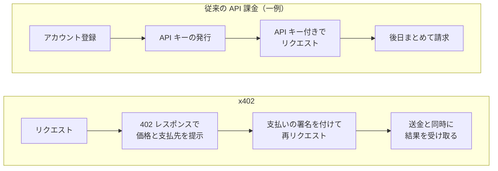
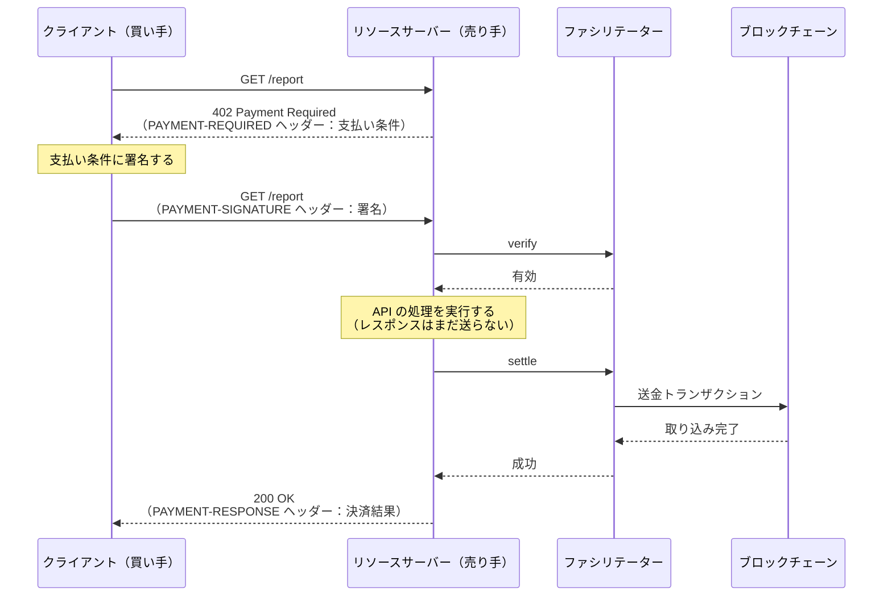
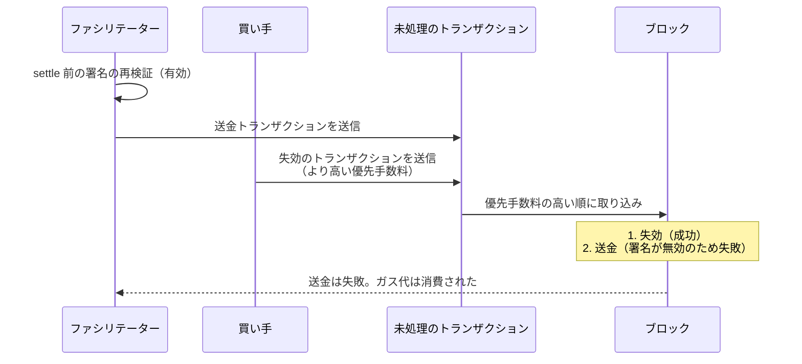
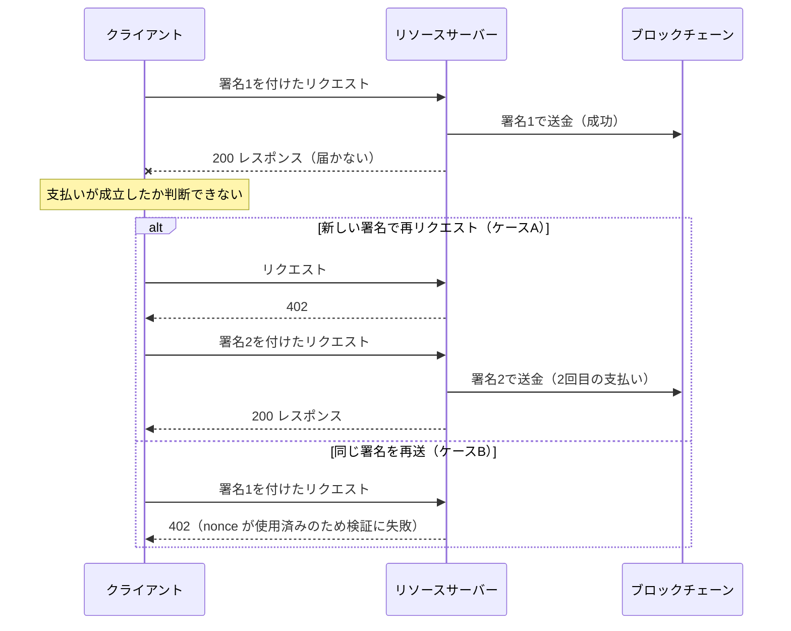
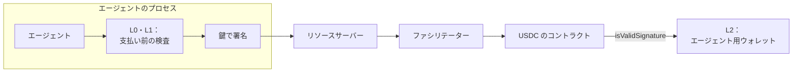

# 支払えることと、決済できること
## x402を実装して考える、ステーブルコインとAIエージェントの現在地

<!--
ドラフト v0.3（2026-10-16）
- v0.2 へのフィードバックを反映：用語の注釈と参考文献、コンソール出力の廃止（図と表に置き換え）、
  「ファシリテーター」表記、x402 の定義と概念図（mermaid）、ファイル名など前提知識の説明、
  コード例の出典と説明、英語引用の日本語化、表の整理。
- 数値はすべて本リポジトリの results/*.log による。実験コードは lab/ と contracts/。
- [要確認] は、本実験の外の事実で、出典を確認する必要がある箇所。
- 本文中の [n] は末尾の参考文献の番号。
-->

## はじめに

ブロックチェーンで送金するには、送金額とは別にガス代[^gas]が必要になる。ガス代はそのチェーンの基軸通貨（Ethereum では ETH）で支払う。そのため、USDC[^usdc]を100ドル分持っていても、ETH を持っていなければ USDC を送金できない。

この制約を回避する方法として、署名で送金を承認し、ガス代は別の者が支払う方式が提案されてきた。メタトランザクション[^metatx]、EIP-2612[^2612]、EIP-3009、Permit2[^permit2]がその例である（EIP については脚注[^eip]を参照）。x402 はこの系統に属するプロトコルで、HTTP の`402 Payment Required`ステータスを使い、API の呼び出しの際にステーブルコインで代金を支払う。AI エージェントが自律的に支払うための仕組みとして紹介されることが多い。

本稿の出発点は次の疑問である。ガス代を持たずに支払えることは、決済における主要な課題なのか。カード決済や銀行振込には、もともとガス代に相当する負担がない。ブロックチェーン固有の制約をブロックチェーン上の技術で解消しても、それが決済一般の課題の解決になるとは限らない。

本稿では、この疑問を実装と実験で検討する。x402 の公式 SDK と、Circle が公開している USDC の実装をローカルのブロックチェーン上で動かし、まず正常な支払いを1件成立させる。次に、署名の失効、レスポンスの喪失、同時リクエストといった失敗条件を加えて挙動を観察する。最後に、AI エージェントに持たせるウォレット[^wallet]を設計し、どの制約をどの層で強制できるかを調べる。

検討の軸は次の三つの区別である。

- 署名が正しいこと
- 送金が成立すること
- 購入が適切に成立すること

実験のコードと結果はすべて公開している[19]。本文には、挙動の違いに関係する部分だけを抜粋する。

[^gas]: ブロックチェーン上で処理（トランザクション）を実行するときに、実行を依頼した者が支払う手数料。
[^usdc]: 米ドルと価格が連動するように設計されたトークン（ステーブルコイン）の一つで、Circle 社が発行する。銀行預金そのものではない。Ethereum 上では ERC-20（トークンの標準規格）のコントラクトとして実装されている。
[^metatx]: 利用者は署名だけを作り、別の者がそれをトランザクションとして送信してガス代を負担する方式の総称。
[^2612]: ERC-20 トークンの「承認」（第三者に一定額の引き出しを許可する操作）を、トランザクションではなく署名で行う規格[11]。
[^permit2]: Uniswap が公開しているコントラクト。任意の ERC-20 トークンについて、署名による承認と送金を可能にする[12]。
[^eip]: EIP（Ethereum Improvement Proposal）は Ethereum の改善提案の文書。トークンやウォレットなどアプリケーション層の規格は ERC（Ethereum Request for Comments）とも呼ばれ、EIP-3009 は ERC-3009 とも表記される。
[^wallet]: 資産を保持し、送金などの操作を行うためのアカウント。本稿では、秘密鍵で直接操作するアカウント（EOA）と、コントラクトで実装されたアカウント（スマートウォレット）の両方を扱う。

---

## 1. x402とは何か

### 定義

x402 は、HTTP のリクエストとレスポンスの中で、API やコンテンツの代金を支払うためのオープンな規格である[1]。代金が必要なリクエストに対して、サーバーは HTTP ステータス 402 と支払い条件を返す。クライアントは支払いの署名をヘッダーに付けて、同じリクエストを再送する。サーバーは署名を確認し、送金を実行したうえで結果を返す。

x402 のリポジトリの説明は、暗号資産だけでなく法定通貨の決済手段も対象にすることを目標に掲げている[5]。ただし、本稿執筆時点の公式 SDK が実装している方式は、いずれもブロックチェーン上のトークンの送金である[5]。

HTTP の 402 は、HTTP の仕様（RFC 9110）で「将来の使用のために予約」とされ、具体的な使い方が定められていなかったステータスコードである[6]。x402 はこの 402 に具体的な手順を与える。

従来の API の課金と比べると、x402 で変わるのは図1の部分である。



図1：従来の API 課金と x402 の比較

利用者の識別（アカウントと API キー）と事後の請求が、リクエストごとの支払いに置き換わる。

### 登場する三者と処理の流れ

x402 の登場者は三者である[1]。

- クライアント：買い手。支払い条件を読み、署名を作る。
- リソースサーバー：売り手。代金を受け取って API を提供する。
- ファシリテーター（facilitator）：署名を検証し、ブロックチェーンへの送金を実行する。ガス代はファシリテーターが支払う。リソースサーバーがファシリテーターを兼ねてもよい。

ファシリテーターの処理は二段階に分かれている。

- verify（検証）：署名と支払い条件を確認する。ブロックチェーンの状態は変更しない。
- settle（決済）：送金のトランザクションを送信し、ブロックチェーンへの取り込みを待つ。

全体の流れは図2のとおりである。



図2：x402 の処理の流れ（既定の authorization フロー）

支払い条件、署名、決済結果は、いずれも JSON を base64 で文字列にしてヘッダーに載せる[2]。支払い条件には、ネットワーク、トークン、金額、宛先アドレス、署名の有効期間などが含まれる。

図2の順序（verify → API の処理 → settle → レスポンス）は、仕様が既定としている「authorization フロー」である[1]。仕様は、settle を先に行う「upfront フロー」（settle → API の処理 → レスポンス）なども定義している。exact 方式の仕様[3]は、authorization フローを優先するよう求めている。理由は、API の処理が失敗した場合に買い手が支払わずに済むためである。upfront フローでは、API の処理が失敗しても買い手の支払いは確定しており、仕様は返金の手順を定めていない。本稿の実験はすべて authorization フローで行った。

### EIP-3009 による署名送金

x402 にはいくつかの支払い方式があり、本稿で扱うのは EVM[^evm]系のブロックチェーン向けの exact 方式（指定した額をそのまま支払う方式）である[4]。この方式は、トークンの送金に既定で EIP-3009 の`transferWithAuthorization`という関数を使う[9]。買い手は次の6項目に、EIP-712[^712]の形式で署名する。

| 項目 | 内容 |
| --- | --- |
| from | 送金元（買い手） |
| to | 送金先（売り手） |
| value | 金額 |
| validAfter / validBefore | この署名が有効な期間 |
| nonce[^nonce] | 署名ごとに異なる32バイトの値 |

この署名を保持する者は誰でも、トークンのコントラクトに署名内容どおりの送金を実行させることができる。ガス代は実行した者が負担し、署名者は負担しない。署名に宛先と金額が含まれるため、ファシリテーターはそれらを変更できない。nonce は一度使用すると再使用できないため、同じ署名で2回送金することはできない。

exact 方式の EVM 向け仕様[4]は、ファシリテーターの verify の手順として、署名の検証、残高の確認、金額と有効期間の確認、トークンとネットワークの一致の確認、送金のシミュレーション[^sim]を挙げている。

[^evm]: Ethereum Virtual Machine。Ethereum のスマートコントラクトの実行環境。Ethereum と、同じ実行環境を持つチェーン（Base など）を EVM 系と呼ぶ。
[^712]: 構造化されたデータに署名するための規格[8]。署名対象に「どのチェーンの、どのコントラクト向けか」（ドメインと呼ぶ）を含めるため、別のコントラクトで署名を流用できない。USDC の場合、ドメインにはトークン名 "USD Coin" とバージョン "2" が含まれる。
[^nonce]: 署名付きの操作を一度きりにするための識別値。EIP-3009 では乱数を使う。後述するアカウントのトランザクション番号（同じく nonce と呼ばれる）とは別のものである。
[^sim]: トランザクションを実際には送信せず、現在のブロックチェーンの状態で試行して結果を確認すること。

### 仕様における AI エージェントの扱い

x402 の仕様書には AI エージェントとの統合についての節がある[1]。そこでは、エージェントがリソースに自律的に支払えることなどが挙げられ、予算管理と支出制御は「実装依存」とされている。第4章では、この予算管理と支出制御を実装して比較する。

[要確認：x402 の成立経緯（Coinbase による公開、x402 Foundation への移管の時期など）と、導入事例の現状]

---

## 2. まず支払ってみる

### 実験環境

失敗条件を加える前に、正常な支払いを1件成立させる。

| 部品 | 使ったもの |
| --- | --- |
| ブロックチェーン | anvil（Foundry[16] に含まれる、ローカルで動く EVM 系チェーン） |
| トークン | Circle が公開している USDC の実装（FiatTokenV2_2）[13]をソースからコンパイルしてデプロイ |
| x402 | 公式の TypeScript SDK[5]（npm パッケージ `@x402/*`）のバージョン 2.28.0 を変更せずに使用 |
| その他 | viem[15]（TypeScript 用の Ethereum クライアントライブラリ）、Express（Node.js の Web フレームワーク） |

本番の USDC は、プロキシ[^proxy]を介してアップグレードできる構成になっている。実験ではプロキシを使わず、実装のコントラクトを直接デプロイした。送金と署名検証の処理は本番と同じソースコードである。

[^proxy]: 利用者が呼び出すコントラクト（プロキシ）と処理の本体（実装）を分け、実装を差し替えられるようにする構成。

### 売り手のコード

売り手（リソースサーバー）は Express のアプリケーションで、x402 の SDK が提供するミドルウェア[^mw]を組み込む。

```ts
import express from "express";
import { paymentMiddleware, x402ResourceServer } from "@x402/express";
import { ExactEvmScheme } from "@x402/evm/exact/server";

// ① ファシリテーターとの通信を担うオブジェクト
const resourceServer = new x402ResourceServer(facilitatorClient)
  .register("eip155:31337", new ExactEvmScheme());

const app = express();

// ② ルートごとに支払い条件を設定する
app.use(paymentMiddleware({
  "GET /report": {
    accepts: [{
      scheme: "exact",
      network: "eip155:31337",
      payTo: sellerAddress,
      price: { amount: "10000", asset: usdcAddress, extra: { name: "USD Coin", version: "2" } },
      maxTimeoutSeconds: 120,
    }],
  },
}, resourceServer));

// ③ API の処理。支払いについては何も書かない
app.get("/report", (req, res) => res.json({ report: "..." }));
```

- `@x402/express`は Express 用のパッケージである。`paymentMiddleware`は、指定したルートへのリクエストに支払いを要求するミドルウェアを返す。`x402ResourceServer`は、支払い条件の生成と、ファシリテーターへの verify・settle の依頼を担う。
- `@x402/evm/exact/server`の`ExactEvmScheme`は、EVM 系チェーンの exact 方式について、価格の指定を支払い条件に変換する。`register`の第1引数`"eip155:31337"`はネットワークの識別子で、`eip155`は EVM 系、`31337`は anvil のチェーン ID を表す（CAIP-2 という形式）。
- ① の`facilitatorClient`には、通常はファシリテーターの URL を指定した`HTTPFacilitatorClient`（`@x402/core/server`）を渡す。本稿の実験では、SDK のファシリテーター実装（`@x402/core/facilitator`の`x402Facilitator`）を同じプロセス内で呼び出すオブジェクトを渡した。間には、記録と故障注入のための処理だけを挟んでいる。
- ② の`price`には、金額（`10000`は USDC の最小単位で 0.01 USDC）、トークンのアドレス、署名に必要な EIP-712 のドメイン情報（`name`と`version`）を指定する。`maxTimeoutSeconds`は署名の有効期間（秒）である。
- ③ の API の処理には、支払いに関するコードが含まれない。支払いの処理はすべてミドルウェアの中で行われる。

[^mw]: Express で、ルートの処理の前後に共通の処理を挟む仕組み。

### 買い手のコード

```ts
import { privateKeyToAccount } from "viem/accounts";
import { x402Client, wrapFetchWithPayment } from "@x402/fetch";
import { ExactEvmScheme } from "@x402/evm/exact/client";

const buyer = privateKeyToAccount(BUYER_PRIVATE_KEY);           // ① 署名に使う鍵
const client = new x402Client()
  .register("eip155:*", new ExactEvmScheme(buyer));             // ② EVM 系の exact 方式で支払う
client.setSpendControls({                                       // ③ 支出の制御（後述）
  allowedAssets: [{ network: "eip155:31337", asset: usdcAddress, maxAmountPerPayment: "1000000" }],
});
const payFetch = wrapFetchWithPayment(fetch, client);           // ④ 支払いに対応した fetch

const res = await payFetch("http://localhost:4021/report");     // ⑤ 通常の fetch と同じ使い方
```

- ① `privateKeyToAccount`は viem の関数で、秘密鍵から署名用のアカウントを作る。
- ② `@x402/fetch`の`x402Client`は、受け取った支払い条件から支払いの内容（ペイロード）を作るクライアントである。`@x402/evm/exact/client`の`ExactEvmScheme`は、EIP-3009 の署名を作る部分を担う。`"eip155:*"`はすべての EVM 系ネットワークを表す。
- ③ `setSpendControls`は、支払ってよいトークンと1回あたりの上限額を設定する（理由は次節）。
- ④ `wrapFetchWithPayment`は、標準の`fetch`を包んだ関数を返す。返された関数は、レスポンスが 402 であれば支払い条件を読み、署名を作り、`PAYMENT-SIGNATURE`ヘッダーを付けて同じリクエストを1回だけ再送する。
- ⑤ `payFetch`は本稿のコード上の変数名で、使い方は通常の`fetch`と同じである。

このコードから、後の実験に関係する二点がわかる。第一に、売り手の API の処理（③）は支払いを意識しない。支払いの検証、送金、レスポンスの送信のタイミングはミドルウェアが決める。第二に、買い手が`payFetch`を呼ぶたびに、402 を受け取って新しい署名が作られる。3.2 節の再試行の実験は、この動作に関係する。

### 正常系の結果

実行前後の状態は次のとおりである。

| 項目 | 実行前 | 実行後 |
| --- | --- | --- |
| 買い手の USDC 残高 | 10.00 | 9.99 |
| 売り手の USDC 残高 | 0 | 0.01 |
| 署名の nonce | 未使用 | 使用済み |
| 送金トランザクションの送信者 | — | ファシリテーター |
| API の処理の実行回数 | 0 | 1 |

処理は図2のとおり、verify、API の処理、settle、レスポンスの順に実行された。後の実験では、ETH の残高が0のスマートウォレットからも支払えた。この範囲では、買い手が ETH を持たずに支払えることを確認できた。

SDK のミドルウェアは、API の処理が返したレスポンスをすぐには送らずに保持する。settle が成功するとレスポンスを送り、失敗すると保持したレスポンスを破棄して 402 を返す[17]。したがって、settle が失敗した場合、買い手は API の結果を受け取らない。一方で、API の処理はすでに実行されているため、計算資源は消費され、外部の API を呼び出していればその費用も発生する。

なお、最初の実行では、買い手のコードの ③ を書いていなかったため、402 を受け取った直後にクライアント側でエラーになった。エラーの内容は「支払い条件がすべて支出制御によって拒否された。SDK が既定で認識しているトークンか、allowedAssets に登録したトークンだけが許可される」というものである。SDK のクライアントは既定で、SDK に登録されていないトークンへの支払いを拒否する[18]。ローカルにデプロイした USDC は登録されていないため、③ で許可した。この支出制御については第4章で扱う。

---

## 3. 決済を壊してみる

### 3.1 署名は正しいのに、支払えない

#### 状態に依存する署名

EOA[^eoa]の署名は、暗号学的に検証できる。署名と署名対象のデータから署名者のアドレスが一意に決まり、その結果は時間が経っても変わらない。

スマートウォレットは秘密鍵を持たない。そのため EIP-1271[10]では、ウォレットのコントラクトに`isValidSignature`という関数を実装し、署名が有効かどうかをコントラクト自身に返させる。USDC の実装は、送金元のアドレスがコントラクトの場合、この関数を呼んで署名を確認する。

実験用に、次のウォレットを実装した。

```solidity
// 署名対象のハッシュと署名を受け取り、有効なら決まった値（MAGIC）を返す
function isValidSignature(bytes32 hash, bytes calldata sig) external view returns (bytes4) {
    return _recover(hash, sig) == owner ? MAGIC : INVALID;
}

// owner（このウォレットを操作できる鍵）を交代する
function rotateOwner(address next) external {
    require(msg.sender == owner, "not owner");
    owner = next;
}
```

`_recover`は署名から署名者のアドレスを復元する関数で、`MAGIC`は EIP-1271 が「有効」を表す値として定める`0x1626ba7e`である。署名が有効かどうかは、その時点の owner が署名したかどうかで決まる。owner を交代する（鍵をローテーションする）と、過去に作成した署名はすべて無効になる。

この性質は、USDC の実装の署名検証ライブラリ（SignatureChecker）のコメントにも書かれている[14]。要旨は次のとおりである。

> ECDSA 署名（EOA の署名）と異なり、コントラクトの署名は取り消すことができる。そのため検証結果は時間とともに変わりうる。あるブロックで有効だった署名が、次のブロックで無効になることもある（逆もある）。

x402 の authorization フローでは、verify と settle の間に、少なくとも API の処理の時間だけ間隔がある。

[^eoa]: Externally Owned Account。秘密鍵で直接操作する、通常の Ethereum アカウント。

#### 実験

ファシリテーターが settle を始める直前と、settle のトランザクションを送信した直後に処理を挟み、そこで署名を失効させた。失効の方法は次の二つである。

- スマートウォレット：前述の`rotateOwner`で owner を交代する。
- EOA：EIP-3009 に定義されている`cancelAuthorization`で、署名の nonce を先に使用済みにする。

settle の送信後に失効させるケースでは、ファシリテーターの送金トランザクションが未処理の間に、失効のトランザクションをより高い優先手数料[^tip]で送信した。

いずれのケースでも、失効させなかった場合は正常に決済された。失効させた場合の結果は次のとおりである。

| 失効させた時点 | スマートウォレット（owner 交代） | EOA（cancelAuthorization） |
| --- | --- | --- |
| verify の後、settle の送信前 | 送信前に停止（署名の再検証で検出） | 送信前に停止（ガス見積りで検出） |
| settle の送信後、ブロックへの取り込み前 | 送金が失敗し、ガス代だけが発生 | 送金が失敗し、ガス代だけが発生 |

4ケースすべてで、売り手は代金を受け取らず、API の処理は実行済みで、買い手には 402 が返った。

[^tip]: トランザクションを早くブロックに取り込んでもらうために上乗せする手数料。実験に使った anvil は、既定で優先手数料の高いトランザクションから順にブロックに並べる。

#### 送信前に止まったケース

スマートウォレットのケースは、SDK のファシリテーターが settle の前に署名を再検証した時点で止まった[17]。SDK は、送金元がコントラクトの場合、ブロックチェーン上の`isValidSignature`を呼んで再検証する。トランザクションは送信されず、ファシリテーターの費用は発生していない。

EOA のケースを止めたのは、SDK の明示的な検査ではない。SDK の settle 前の再検証では、送金のシミュレーションは既定で行わない設定になっている（ファシリテーターの設定項目`simulateInSettle`の既定値が`false`）。このケースを止めたのは、viem がトランザクションの送信前に行うガス見積り[^estimate]である。見積りの段階で送金が失敗することが判明し、送信が中止された。

[^estimate]: トランザクションの実行に必要なガスの量を、送信前にシミュレーションで見積もる処理。シミュレーションで処理が失敗すると、見積りもエラーになる。

#### 送信後に失効させたケース

ファシリテーターの送信後に失効させたケースの経過は、図3のとおりである。



図3：settle の送信後に署名を失効させた場合

送金のトランザクションは失敗（revert[^revert]）し、ファシリテーターはガス代だけを支払った。

[^revert]: トランザクションの処理が途中で失敗し、状態の変更がすべて取り消されること。それまでに消費したガス代は戻らない。

#### 結果の解釈

この現象は EIP-1271 に固有ではない。EOA でも`cancelAuthorization`や、残高を別のアドレスへ移す操作で同じ状態になる。原因は、検証と送金が別の時刻に行われることにある。

スマートウォレットの場合、失効は鍵のローテーションのような通常の運用操作によっても起きる。ローテーションを行うと、未決済の支払いはすべて無効になる。

送信後に失効させたケースで、利益を得た者はいない。買い手は API の結果を受け取っていない。費用を負担したのは、API の処理を実行した売り手（計算資源）と、ガス代を支払ったファシリテーターである。この操作を攻撃とみなす場合、その内容は、買い手が自分の支払いを取り消すことで売り手とファシリテーターに費用を負わせるものになる。x402 の EVM 向け仕様は、ERC-7710 という別の送金方式の節で、この競合をファシリテーターのリスクとして記載している[4]。EIP-3009 の節には同様の記載はないが、今回の実験では EIP-3009 でも同じ現象が起きた。

verify を通過した支払いが、settle の時点でも実行可能である保証はない。authorization フローでは、verify から settle までの間に生じる失敗のリスクを売り手が負う。1章で述べたとおり、これは API の処理が失敗した場合に買い手を守るための順序であり、upfront フローを選べばリスクは買い手側に移る。

### 3.2 同じものに二度払う

#### GET の安全性・冪等性と支払い

HTTP の GET は「安全な」メソッドと定義されている[6]。これは、クライアントがサーバーの状態の変更を要求しないという意味である。また GET は冪等（べきとう）であり、同じリクエストを複数回送っても、意図される効果は1回の場合と同じである。そのため、ブラウザや HTTP ライブラリは、通信が切断された GET を再送することがある。

x402 では、GET の処理の中で送金が行われる。

ここで扱う状況は次のとおりである。買い手が支払い、送金はブロックチェーンに取り込まれた。その直後に通信が切断され、成功のレスポンスが買い手に届かなかった。この場合、買い手はレスポンスから支払いが成立したかどうかを判断できない。

この状況を再現するため、リソースサーバー側で、settle の成功後、レスポンスを送信する時点で TCP の接続を切断した。そのうえで、買い手側の再試行のしかたと、売り手側の重複防止の有無を変えて比較した。

#### 再試行のしかたによる違い

対策のない売り手に対する、二通りの再試行の結果は図4のとおりである。



図4：レスポンスの喪失後の再試行（売り手側の対策なし）

売り手側の対策も含めた結果は次のとおりである。

| ケース | 売り手側の重複防止 | 買い手の再試行 | 支払い回数 | 結果を受け取れたか |
| --- | --- | --- | --- | --- |
| A | なし | 新しい署名で再リクエスト | 2 | 受け取れた |
| B | なし | 同じ署名を再送 | 1 | 受け取れない |
| C | payment-identifier | 同じ署名を再送 | 1 | 受け取れた |
| D | payment-identifier | 同じ ID で新しい署名 | 1 | 受け取れない（409） |
| E | payment-identifier | 再起動して ID も署名も新しく作る | 2 | 受け取れた |
| F | アプリの購入 ID | 再起動して新しい署名で再リクエスト | 1 | 受け取れた |

A は、SDK の`payFetch`をもう一度呼んだ場合である。サーバーは再び 402 を返し、SDK は新しい nonce で新しい署名を作る。新しい署名は別の送金として処理されるため、nonce による重複防止は働かない。

B では二重払いは発生しないが、買い手は結果を受け取れない。nonce が防ぐのは同じ署名の再利用であり、同じ購入の繰り返しではない。署名の同一性と購入の同一性は別の概念である。

#### 公式の重複防止の拡張（C・D・E）

x402 には、payment-identifier という拡張機能がある[7]。クライアントが支払いに ID を付け、再試行では同じ ID を使う。サーバーは ID を見て重複を判定する。

SDK が提供するのは、ID を宣言する関数と取り出す関数だけで、重複を判定する処理（ID と結果の記録、照合）は実装者に任されている。SDK のソースコードにも、冪等性（重複防止）のための処理は必要に応じて将来追加できる、という趣旨のコメントがある[17]。そこで実験では、SDK のリポジトリにあるサンプルサーバー[17]と同じ方法で重複判定を実装した。

サンプルサーバーは、ID と、署名を含む支払い内容全体のハッシュを記録する。同じ署名で再送すると、記録済みの結果を返す（C）。同じ ID で新しい署名を送ると、ID が同じで内容が異なるものとして HTTP 409 Conflict[^409]を返す（D）。D では二重払いは発生しないが、買い手は結果を受け取れない。E のように、クライアントが ID を保存しておらず作り直した場合は、別の購入として扱われ、支払いは2回になる。

[^409]: リクエストがサーバーの現在の状態と矛盾するため処理できないことを示すステータスコード。

#### 拒否された署名の扱い

D で 409 が返されたリクエストにも、署名が含まれていた。この署名は使用されておらず、有効期限（`validBefore`）まで有効である。実験で、売り手側がこの署名を使って`transferWithAuthorization`を呼ぶと、送金は成功した（支払いは合計2回、API の処理は1回）。

署名付きの送金承認は、受け取った者が有効期限内であればいつでも実行できる。サーバーが 409 で拒否しても、署名はサーバー側に残る。有効期限は、サーバーが支払い条件の`maxTimeoutSeconds`で指定する（実験では120秒）。

#### アプリの購入 ID（F）と同時リクエスト

F では、支払いの処理より前に、アプリケーション側の購入 ID（例：注文番号）を、認証済みの買い手と結びつけて照合した。購入済みであれば、支払いを求めずに記録済みの結果を返す。この方式では、クライアントが再起動して署名を作り直しても、支払いは1回だった。購入の同一性は、アプリケーション層で扱う必要がある。

ただし、F の実装は同時リクエストに対応していない。同じ購入 ID のリクエストを、レスポンスの喪失なしに同時に2件送ると、両方が未購入と判定されて処理が進み、支払いは2回になった。処理中の購入 ID を記録しておき、2件目に 409 を返すようにすると、支払いは1回になった。

この場合も、409 を受けた側のクライアントは、402 を受け取った時点で署名を作成していた。x402 の手順では、署名の作成はサーバーが支払い付きのリクエストを受け取るより前に行われるため、サーバー側で購入 ID を記録するより先に署名が存在する。

#### 従来の決済 API との共通点と相違点

同時リクエストによる二重払いは、従来の決済 API でも同様に起きる問題である。Stripe などの決済 API は、`Idempotency-Key`ヘッダーで再試行を識別する仕組みを提供している[20][要確認：Stripe の仕様、同時リクエスト時の挙動]。レスポンスが失われた場合に支払いの成否を確認し、購入を1回に限定する処理は、決済手段にかかわらずアプリケーション側の責任である。

ブロックチェーン固有の要素は、拒否された署名が実行可能なまま残る点である。支払いを実行する能力が決済事業者ではなく署名自体にあるため、拒否されたリクエストに含まれていた署名が、有効期限まで支払い手段として機能する。

あわせて観察された現象を記録する。viem の標準の設定でトランザクションを送信するファシリテーター（SDK のリポジトリにあるファシリテーターのサンプルと同じ構成）は、2件の settle を同時に処理すると、送信アカウントのトランザクション番号（nonce）が衝突し、片方の送信が`nonce too low`（その番号はすでに使われている）というエラーで失敗した。この実験ではその結果として二重払いは発生しなかったが、API の処理は2回実行され、片方の買い手には 402 が返った。ファシリテーターは単一のアカウントからトランザクションを送信するため、並行処理にはトランザクション番号の管理が必要になる。

---

## 4. AIの財布を設計する

### 支払いの可否を判断する層

x402 は支払いの手順を定めるが、AI エージェントが支払ってよいかどうかの判断は定めていない。仕様が実装に委ねた予算管理を、三つの層で実装して比較した。各層の位置は図5のとおりである。



図5：支出を制限する三つの層の位置

- L0：SDK の既定の支出制御（`setSpendControls`）。1回あたりの上限額と、支払ってよいトークンを制限する。
- L1：クライアントの独自の方針。L0 に加えて、SDK のフック[^hook]で「支払先の許可リスト」「タスクあたりの予算」「同じ URL の再購入の禁止」「署名の有効期間の上限」を実装する。
- L2：オンチェーン。クライアント側では制御を行わない（SDK の支出制御も無効にする）。エージェントには、スマートウォレットのセッション鍵[^session]だけを渡し、ウォレットのコントラクトが制約を課す。クライアント側の制約が迂回された状況に相当する。

[^hook]: ライブラリの処理の途中で、利用者が用意した関数を呼び出す仕組み。
[^session]: ウォレットの持ち主が、操作できる範囲を限定して別の鍵に与える権限。ここではエージェントに渡す鍵を指す。持ち主の鍵（owner）は別に保持する。

L1 は、SDK の二つのフックで実装した。`registerPolicy`は、サーバーが提示した支払い条件の候補を絞り込む関数を登録する。`onBeforePaymentCreation`は、署名を作る直前に呼ばれる関数を登録し、`{ abort: true }`を返すと支払いを中止できる。

```ts
// 支払先が許可リストにない支払い条件を除外する
client.registerPolicy((_version, reqs) => reqs.filter(r => allowedPayees.has(r.payTo.toLowerCase())));

// 署名を作る直前に検査する
client.onBeforePaymentCreation(async ({ paymentRequired, selectedRequirements: r }) => {
  if (r.maxTimeoutSeconds > 600) return { abort: true, reason: "署名の有効期間が長すぎる" };
  if (bought.has(url))          return { abort: true, reason: "同じものを購入済み" };
  if (committed + BigInt(r.amount) > budget) return { abort: true, reason: "タスク予算超過" };
  committed += BigInt(r.amount);   // 署名を作った時点で予算を消費したとみなす
  bought.add(url);
});
```

予算は、送金の確定時ではなく、署名の作成時に消費したものとして計上した。3.2 節のとおり、署名は有効期限まで実行される可能性があるためである。

### EIP-1271 で支払い内容を検査する方法

L2 のウォレットは、EIP-1271 の`isValidSignature`の中で支払い内容を検査する。ただし、この関数が受け取るのは、32バイトのハッシュ（署名対象のデータの要約値）と署名だけである。ハッシュから宛先や金額を復元することはできない。

そこで、署名のバイト列に支払い内容（EIP-3009 の6項目）を同梱させた。ウォレットは、同梱された内容からハッシュを計算し直し、渡されたハッシュと一致することを確認してから、内容を検査する。

```solidity
function isValidSignature(bytes32 hash, bytes calldata sig) external view returns (bytes4) {
    // 署名のバイト列を「支払い内容」と「セッション鍵の署名」に分解する
    (Authorization memory a, bytes memory inner) = abi.decode(sig, (Authorization, bytes));
    if (_digest(a) != hash)                          return INVALID; // 同梱された内容が署名対象と一致するか
    if (!allowedPayee[a.to])                         return INVALID; // 支払先が許可されているか
    if (a.value > maxPerPayment)                     return INVALID; // 1回の額が上限以下か
    if (a.validBefore > block.timestamp + maxWindow) return INVALID; // 署名の有効期間が長すぎないか
    if (_recoverMem(hash, inner) != sessionKey)      return INVALID; // セッション鍵の署名か
    return MAGIC;
}
```

（持ち主の鍵による署名を受け付ける分岐は省略した）

x402 の SDK は署名をバイト列のまま扱い、USDC の実装もそれを`isValidSignature`にそのまま渡す。そのため、この方式は SDK と USDC の実装を変更せずに動作した。

### 実験

5つのシナリオを三つの層で実行した。L0 と L1 の1回の上限は 1 USDC、L2 は 0.5 USDC とした。L2 のウォレットには 1 USDC だけを入金した。正規の API への通常の支払い（0.01 USDC）は、三つの層のいずれでも成功した。

| シナリオ | L0 SDK の既定 | L1 クライアントの方針 | L2 オンチェーン |
| --- | --- | --- | --- |
| 未知の支払先（すり替えられた API） | 支払った | 止めた | 止めた |
| 正規の支払先が 0.9 USDC を要求 | 支払った | 支払った（※） | 止めた |
| 同じレポートを3回購入 | 3回支払った | 1回で止めた | 3回支払った |
| 0.3 USDC の別々の購入を6回 | 6回支払った（1.8 USDC） | 3回で止めた（予算） | 3回で止めた（残高） |
| 有効期間1年の署名を要求 | 支払った | 止めた | 止めた |

※ L1 の1回の上限を 1 USDC に設定していたため。

L0 の結果から、SDK の既定の支出制御が検査するのは、1回の額とトークンの種類だけであることがわかる。支払先、累積額、重複、署名の有効期間は検査しない。サーバーが有効期間に1年を指定すると、1年間有効な署名が作成された。

L1 の制約は、エージェントと同じプロセスの中で動作する（図5）。そのため、鍵を持つプロセスが別の経路で署名すれば、迂回できる。

L2 は、クライアント側の制御がない状態で、支払先、1回の額、署名の有効期間を強制した。セッション鍵が漏洩した場合も、支払いはこれらの制約の範囲に限られる。ただし、持ち主の鍵（owner）にはこの制約がかからない。

### 累積額の制限

L2 で6回の購入を3回で止めたのは、ウォレットのコードによる検査ではなく、残高の不足である。

ウォレットで累積の支出額を数えられるかを確かめるため、`isValidSignature`の中で支払い回数を記録しようとするウォレットを実装した。結果は 402 で、記録は0回だった。USDC のコントラクトは`isValidSignature`を`staticcall`[^staticcall]で呼ぶため、状態の書き込みは失敗する。

なお、ファシリテーターの署名検証はこのウォレットでも通過した。ファシリテーターは`isValidSignature`を`eth_call`[^ethcall]で直接呼び出しており、この呼び出しでは書き込みが禁止されないためである。支払いを止めたのは、その後の送金のシミュレーションだった。

EIP-3009 の送金の経路には、ウォレットが自身の状態を更新する箇所がない。したがって、オンチェーンで強制できる累積の上限は、実質的にウォレットの残高になる。エージェントのウォレットには、予算として許容する額（例：1日分）だけを入金しておく構成が必要になる。

[^staticcall]: 呼び出し先のコントラクトに状態の変更を許さない呼び出し方。呼び出し先が書き込もうとすると失敗する。
[^ethcall]: ブロックチェーンのノードに、トランザクションを送らずに関数を実行させる API。結果は返るが、状態の変更は保存されない。

### 重複購入の検出

同じレポートの3回の購入を止めたのは L1 だけである。オンチェーンのウォレットから見ると、3件の送金はそれぞれ条件を満たす別の支払いである。同じものを購入したかどうかは、購入の文脈を持つクライアントまたはアプリケーションの層でしか判定できない。

今回はエージェントを決定論的なプログラムで代用しており、LLM を接続した場合（例：ツールの応答が予算の上限の解除を指示する場合）の挙動は検証していない。L1 の制約はエージェントと同じプロセス内にあり、L2 の制約はコントラクトにある。LLM の出力がどちらの制約に影響しうるかは、エージェントの構成に依存する（未検証）。

---

## 5. それでも x402 は必要か

### ガス代の負担の移動

はじめにの疑問について、実験の範囲で確認できたことは次のとおりである。

ガス代の問題は解消されていた。ETH を持たないウォレットから支払えた。ただし、ガス代はファシリテーターの負担に移っており、3.1 節のとおり、失敗したトランザクションのガス代もファシリテーターが負担しうる。また、authorization フローでは、売り手は送金が確定する前に API の処理費用を負担している。

実験で実装と検証に手間を要した問題は、いずれもガス代とは関係がなかった。

- レスポンスが失われたときに、支払いの成否をどう確認するか
- 「同じ署名」ではなく「同じ購入」をどう識別するか
- 同時に届いたリクエストをどう1回に限定するか
- 受け付けなかった署名をどう無効にするか
- 支払ってよい相手、額、回数、期間を、どの層で保証するか

これらの多くは従来の決済 API にもある問題で、ブロックチェーンを使っても解決されない。また、署名が支払いを実行する能力を持つため、拒否された署名が残るというブロックチェーン固有の問題も加わる。

### 従来の決済手段と比べた x402 の性質

x402 には、従来の決済手段と異なる次の性質がある。いずれも本稿の実験では評価していない。

第一に、アカウントを作らずに購入できる。API キーの発行、契約、月次の請求を経ずに、機械が読める形式で価格を受け取り、その場で支払える。登録の手続きを自ら行えないエージェントにとっては、この点が利点になる。

第二に、ブロックに取り込まれた送金は、決済事業者の判断で取り消されない。これは売り手にとっての利点であり、買い手にとってはチャージバック（カード会社などを通じた支払いの取り消し）による救済がないことを意味する[要確認：各種カード決済のチャージバック制度との比較]。第4章でエージェントのウォレットに複数の制約を設けたのは、誤った支払いを取り消す手段がないためである。

一方で、利用者はウォレットの用意、USDC の入手、鍵の管理、支出制約の実装を行う必要がある。アカウント登録の手続きは、これらの準備に置き換わる。どちらの負担が小さいかは利用者によって異なる。

### 支払いの判断

AI エージェントが支払いを行う場合、価格の妥当性や支払先の信頼性を誰が判断するかが問題になる。SDK の既定の支出制御は、未知の支払先への支払いにも、1年間有効な署名の要求にも応じた。x402 が定めているのは支払いの手順であり、購入の適否の判断は定めていない。仕様は予算管理を実装依存としており、本稿の実験で実装の手間を要した部分の多くはこの範囲に含まれていた。

本稿の実験を通じて残った問いは、お金を動かす技術の進歩に比べて、お金を使う判断の難しさが扱われていないのではないか、というものである。これは結論ではない。

x402 は送金の部分を設計している。実験では、nonce は同じ署名の再利用を防ぎ、ファシリテーターは宛先と金額を変更できず、settle の前には署名が再検証された。一方、署名が正しいこと、送金が成立すること、購入が適切に成立することの間にある差は、プロトコルの外側、すなわち売り手と買い手それぞれの実装で扱う必要がある。

---

## 付録：実験の範囲

使ったもの：x402 の仕様と SDK のソース（コミット`faa1c694`）、npm パッケージ`@x402/*`のバージョン 2.28.0、viem 2.57.7、Circle の USDC 実装（`stablecoin-evm`のコミット`fc85788`の FiatTokenV2_2）、Foundry 1.7.1（anvil）、Solidity コンパイラ 0.6.12 / 0.8.30、Node.js 22.22.0。

本番環境との違い：

- USDC はプロキシを使わず、実装のコントラクトを直接デプロイした。
- ファシリテーターは別のサーバーに分けず、リソースサーバーと同じプロセスで動かした。
- 実験用ウォレットの署名形式は簡略化している（実在のスマートウォレットの多くは、署名対象のハッシュをウォレット独自の形式で包み直してから署名する）。
- SDK は失敗の原因を調べるために Multicall3（複数の読み取りを1回の呼び出しにまとめるコントラクト）を使うが、anvil の初期状態には存在しない。そのため、一部のエラーの理由が「シミュレーションの失敗」という汎用的なものになった。

実施していないこと：テストネットと本番ネットワークでの検証、Permit2 と ERC-7710 による送金方式、upfront フロー、EIP-7702[^7702]、LLM を接続したエージェント、`simulateInSettle`を`true`にした場合の挙動、従来の決済 API との実測による比較。

再現方法：リポジトリ[19]の README の手順で、全実験を約40秒で再実行できる。

[^7702]: 通常のアカウント（EOA）に、コントラクトのコードの実行を委任できるようにする提案。

---

## 参考文献

x402 の仕様と SDK は、本稿の実験で使ったコミット`faa1c694c66a3732aaabbce93bdae140e521a67d`のものを参照した。

1. x402 仕様 v2（コアプロトコル）. https://github.com/x402-foundation/x402/blob/faa1c694c66a3732aaabbce93bdae140e521a67d/specs/x402-specification-v2.md
2. x402 仕様 v2（HTTP トランスポート）. https://github.com/x402-foundation/x402/blob/faa1c694c66a3732aaabbce93bdae140e521a67d/specs/transports-v2/http.md
3. x402 仕様 exact 方式. https://github.com/x402-foundation/x402/blob/faa1c694c66a3732aaabbce93bdae140e521a67d/specs/schemes/exact/scheme_exact.md
4. x402 仕様 exact 方式（EVM）. https://github.com/x402-foundation/x402/blob/faa1c694c66a3732aaabbce93bdae140e521a67d/specs/schemes/exact/scheme_exact_evm.md
5. x402 リポジトリ（README、TypeScript SDK は`typescript/`以下）. https://github.com/x402-foundation/x402/tree/faa1c694c66a3732aaabbce93bdae140e521a67d
6. RFC 9110: HTTP Semantics（§9.2.1 Safe Methods、§9.2.2 Idempotent Methods、§15.5.3 402 Payment Required）. https://www.rfc-editor.org/rfc/rfc9110.html
7. x402 拡張仕様 payment-identifier. https://github.com/x402-foundation/x402/blob/faa1c694c66a3732aaabbce93bdae140e521a67d/specs/extensions/payment_identifier.md
8. EIP-712: Typed structured data hashing and signing. https://eips.ethereum.org/EIPS/eip-712
9. ERC-3009: Transfer With Authorization. https://eips.ethereum.org/EIPS/eip-3009
10. ERC-1271: Standard Signature Validation Method for Contracts. https://eips.ethereum.org/EIPS/eip-1271
11. ERC-2612: Permit Extension for EIP-20 Signed Approvals. https://eips.ethereum.org/EIPS/eip-2612
12. Uniswap Permit2. https://github.com/Uniswap/permit2
13. Circle stablecoin-evm（USDC の実装）. https://github.com/circlefin/stablecoin-evm
14. Circle stablecoin-evm, SignatureChecker.sol. https://github.com/circlefin/stablecoin-evm/blob/fc85788bc7c23cefe3df1a757133048bfddadeaa/contracts/util/SignatureChecker.sol
15. viem. https://viem.sh
16. Foundry. https://getfoundry.sh
17. x402 SDK のソースコード（いずれも上記コミット）
    - Express ミドルウェア：`typescript/packages/http/express/src/index.ts`
    - ファシリテーターの EIP-3009 処理：`typescript/packages/mechanisms/evm/src/exact/facilitator/eip3009.ts`
    - payment-identifier 拡張：`typescript/packages/extensions/src/payment-identifier/resourceServer.ts`
    - payment-identifier のサンプルサーバー：`examples/typescript/servers/payment-identifier/index.ts`
18. x402 SDK のクライアントの支出制御：`typescript/packages/core/src/client/x402Client.ts`（上記コミット）
19. 本稿の実験リポジトリ. https://github.com/avcdsld/x402-techbook-lab
20. Stripe API Reference, Idempotent requests. https://docs.stripe.com/api/idempotent_requests [要確認]
